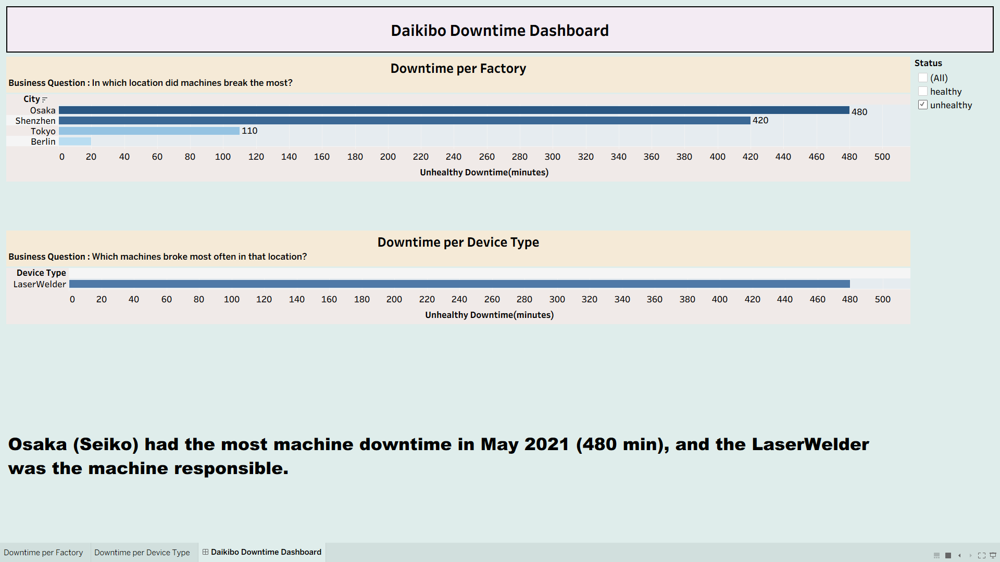
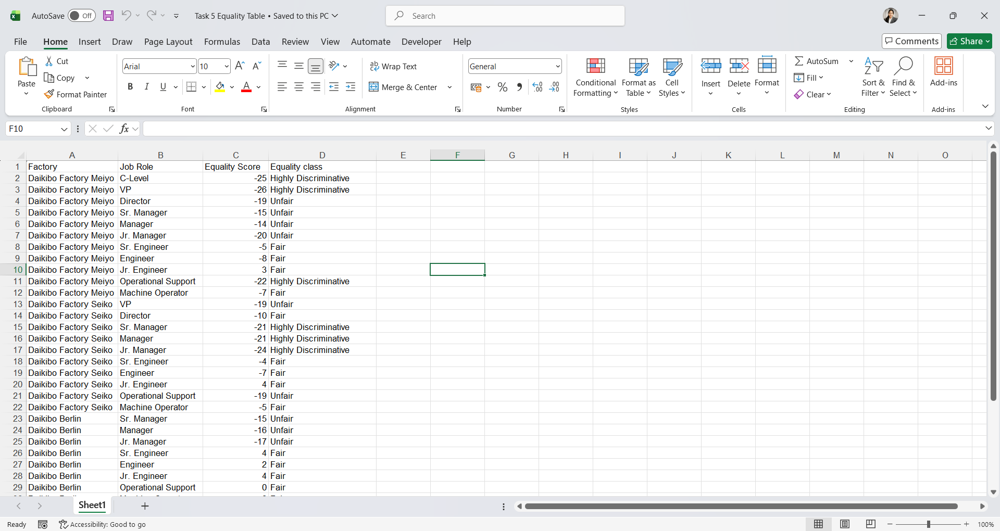

# Deloitte Data Analytics Job Simulation – Forage
Virtual job simulation completed on [Forage](https://www.theforage.com/), where I worked on tasks that mirror the day-to-day work of a Deloitte data analyst.

## Tasks Completed

### Task 1: Data Analysis and Dashboard Creation
- Used **Tableau** to explore the client dataset and build a dashboard 
- Identified key trends and insights: [e.g., top-performing categories, patterns over time]
- Screenshots:
### Task 2: Forensic Technology – Excel Analysis
- Used **Excel** to classify data and draw conclusions
- Techniques used: IF Function {=IF(AND(C2>=-10,C2<=10),"Fair",IF(OR(C2<-20,C2>20),"Highly Discriminative","Unfair"))}
- Screenshots:
  

## Key Findings
1. [Finding 1, with a number if possible]
2. [Finding 2]
3. [Finding 3]

## Skills Demonstrated
Data analysis · Data visualization · Tableau · Excel · Business communication · Data-driven recommendations

## Certificate
[View my completion certificate](./Deloitte_Virtual_Internship_Certificate.pdf)

## Author
**Aaditi Salunkhe** · [LinkedIn](your-link-here)
